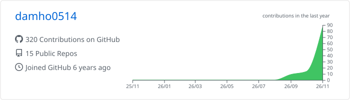
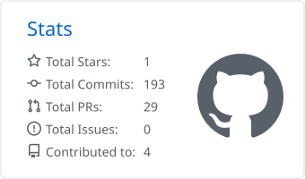
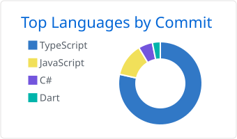

# 안녕하세요, damho입니다 👋

웹 프론트엔드에서 출발해 모바일 멀티플레이 게임까지, 
직접 써 보고 싶은 서비스를 끝까지 만들어 보는 개발자입니다.

## 🛠 Tech Stack

| 분야 | 기술 |
|---|---|
| Web |  |
| Mobile · Game |  |
| Tools |  |

## 🚀 Projects

| 프로젝트 | 설명 | 기술 |
|---|---|---|
| [**Voxel Valley**](https://github.com/damho0514/voxel-valley) | 블록으로 만드는 우리만의 계곡. 서바이벌, 물·수영, 낮과 밤, 채팅까지 갖춘 모바일 복셀 샌드박스. Unity Relay로 온라인 멀티플레이 지원 | Unity 6 · C# · Netcode |
| [**Mingle Town**](https://github.com/damho0514/mingle-town) | 동시 접속자들이 캐릭터로 만나 노는 공간 게임. 여러 개의 광장, 아바타 꾸미기, 서버 판정 술래잡기 미니게임 | Flutter · Flame · Dart WebSocket |
| [**DAMO 안심 가로등**](https://github.com/damho0514/Solar_Power_AI) | AI가 도로를 보고 필요한 곳만 가로등을 밝히고, 어린이보호구역 위험을 알리는 관제 서비스 시연판 · [데모](https://damo-ai.vercel.app) | Next.js · TypeScript · AI |

📚 학습 기록

- [react-ts-calender](https://github.com/damho0514/react-ts-calender) · [calender-example](https://github.com/damho0514/calender-example): React + TypeScript 캘린더
- [InfinyteTable_filtering](https://github.com/damho0514/InfinyteTable_filtering): 무한 스크롤 테이블 필터링
- [github-rest-api](https://github.com/damho0514/github-rest-api): GitHub REST API 활용
- [BDH_ToDoPage](https://github.com/damho0514/BDH_ToDoPage) · [react-todo-typescirpt](https://github.com/damho0514/react-todo-typescirpt): TODO 앱
- [side-project](https://github.com/damho0514/side-project) · [toyProject](https://github.com/damho0514/toyProject) · [ReactPractice](https://github.com/damho0514/ReactPractice): 사이드 프로젝트와 React 연습

## 📊 GitHub Stats

<picture>
  <source media="(prefers-color-scheme: dark)" srcset="./profile-summary-card-output/github_dark/0-profile-details.svg" />
  
</picture>

<picture>
  <source media="(prefers-color-scheme: dark)" srcset="./profile-summary-card-output/github_dark/3-stats.svg" />
  
</picture>
<picture>
  <source media="(prefers-color-scheme: dark)" srcset="./profile-summary-card-output/github_dark/2-most-commit-language.svg" />
  
</picture>

<picture>
  <source media="(prefers-color-scheme: dark)" srcset="https://streak-stats.demolab.com/?user=damho0514&theme=github-dark-blue&hide_border=true&locale=ko" />
  
</picture>

## 🐍 Contributions

<picture>
  <source media="(prefers-color-scheme: dark)" srcset="https://raw.githubusercontent.com/damho0514/damho0514/output/github-snake-dark.svg" />
  
</picture>
