<picture>
  <source media="(prefers-color-scheme: dark)" srcset="./assets/header-dark.svg" />
  
</picture>

 

### &nbsp; About

웹 그래픽 디자이너로 일을 시작했고, 지금은 5년 차 프론트엔드 개발자입니다.
예전엔 툴 위에서 화면을 그렸고, 요즘은 그 화면을 직접 코드로 움직입니다.

버튼을 눌렀을 때의 반응, 화면이 넘어갈 때의 속도 같은 작은 차이가 사용 경험을 바꾼다고 믿어요.
처음 보는데 이상하게 손이 가는 인터페이스를 발견하면 꼭 뜯어보고 따라 만들어 봅니다.

- 디자인 시안을 픽셀 단위로 옮기고, 모션과 인터랙션까지 챙기는 일
- 사용자 입장에서 한 번 더 눌러 보고, 불편한 흐름을 먼저 찾아내는 일
- 요즘은 웹 밖으로 나가 Flutter, Unity로 작은 멀티플레이 게임을 만들고 있어요

### &nbsp; Stack

 

&nbsp;

### &nbsp; Work

**[Voxel Valley](https://github.com/damho0514/voxel-valley)** &nbsp;Unity 6 · C# · Netcode 
블록을 쌓아 각자의 계곡을 꾸미는 모바일 샌드박스. 친구와 접속 코드 하나로 같이 들어올 수 있어요.

**[Mingle Town](https://github.com/damho0514/mingle-town)** &nbsp;Flutter · Flame · WebSocket 
같은 시간에 접속한 사람들이 캐릭터로 만나 노는 광장. 모자 고르기, 술래잡기 같은 소소한 놀이를 넣었습니다.

**[DAMO 안심 가로등](https://github.com/damho0514/Solar_Power_AI)** &nbsp;Next.js · TypeScript 
도로 영상을 보고 필요한 곳만 가로등을 밝히는 관제 화면 시연판. [직접 보기](https://damo-ai.vercel.app)

그 밖에 만들어 본 것들

 

[react-ts-calender](https://github.com/damho0514/react-ts-calender) · [calender-example](https://github.com/damho0514/calender-example) · [InfinyteTable_filtering](https://github.com/damho0514/InfinyteTable_filtering) · [github-rest-api](https://github.com/damho0514/github-rest-api) · [BDH_ToDoPage](https://github.com/damho0514/BDH_ToDoPage) · [side-project](https://github.com/damho0514/side-project) · [toyProject](https://github.com/damho0514/toyProject) · [ReactPractice](https://github.com/damho0514/ReactPractice)

### &nbsp; Activity

<picture>
  <source media="(prefers-color-scheme: dark)" srcset="./profile-summary-card-output/github_dark/3-stats.svg" />
  
</picture>
<picture>
  <source media="(prefers-color-scheme: dark)" srcset="./profile-summary-card-output/github_dark/2-most-commit-language.svg" />
  
</picture>

<picture>
  <source media="(prefers-color-scheme: dark)" srcset="https://streak-stats.demolab.com/?user=damho0514&theme=github-dark-blue&hide_border=true&locale=ko" />
  
</picture>

### &nbsp; Contributions

<picture>
  <source media="(prefers-color-scheme: dark)" srcset="https://raw.githubusercontent.com/damho0514/damho0514/output/github-snake-dark.svg" />
  
</picture>
